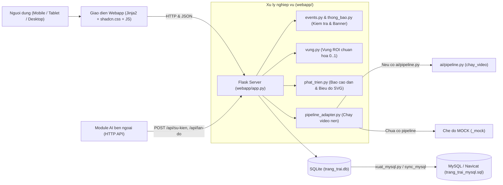
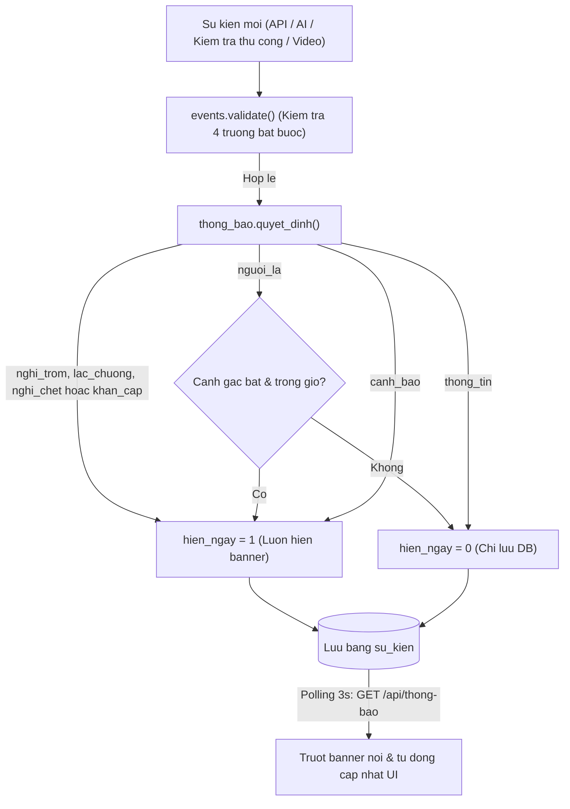

# BÁO CÁO TIẾN ĐỘ & TRÌNH BÀY HỆ THỐNG GIÁM SÁT TRANG TRẠI LỢN (DAKHMT)

**Dự án:** `Pig_Farm_DS_445` (Đồ án Khoa học Máy tính — Hệ thống giám sát trang trại lợn thông minh qua camera)  
**Nhánh làm việc hiện tại:** `Thanh` (2 commit: `6bb809f`, `79c22f8` + các nâng cấp mới trong working tree)  
**Phạm vi tài liệu:** Tổng hợp toàn bộ kiến trúc, chức năng đã hoàn thiện ở Backend, Xử lý video/AI, Cơ sở dữ liệu (SQLite & MySQL) và Giao diện Webapp để phục vụ buổi báo cáo và demo trực tiếp.

---

## 1. Thông tin chung & Mục tiêu hệ thống

Hệ thống **SmartFarm AI** được xây dựng nhằm hỗ trợ chủ trang trại theo dõi đàn lợn theo thời gian thực thông qua hệ thống camera giám sát tại từng ô chuồng, giảm công sức kiểm tra thủ công và cảnh báo sớm các rủi ro bất thường.

### Các mục tiêu cốt lõi đã giải quyết
1. **Giám sát trực quan theo phong cách camera Imou:** Xem luồng ảnh/camera từng ô chuồng, bật/tắt lớp vùng AI trực tiếp trên khung hình, chuyển nhanh giữa các ô, chụp ảnh và cập nhật ảnh/video nền.
2. **Tích hợp AI linh hoạt (Chế độ Tự động & Thủ công):**
   - **Tự động theo lịch:** Bật/tắt 6 tác vụ AI kèm khung giờ/tần suất cấu hình trong cài đặt (`dem_lon`, `canh_gac`, `phat_trien`, `an_uong`, `lac_chuong`, `suc_khoe`).
   - **Kiểm tra thủ công ngay trên màn hình camera:** Cho phép kích hoạt kiểm tra tức thời từng tác vụ hoặc mô phỏng tình huống cảnh báo để kiểm chứng phản ứng của hệ thống.
3. **Phát hiện sớm & cảnh báo phân tầng:** Xử lý 9 loại sự kiện thuộc 3 mức độ (`khan_cap`, `canh_bao`, `thong_tin`), tự động quyết định sự kiện nào hiển thị banner nổi tức thời hay chỉ lưu lịch sử, kèm cơ chế phản hồi `Đúng` / `Báo nhầm`.
4. **Quản lý đàn, ô chuồng & tăng trưởng:** Quản lý danh sách ô chuồng (thêm/sửa/xóa), theo dõi cân nặng từng cá thể theo thời gian, tính độ đồng đều, phân nhóm **Con còi**, **Con lớn nhanh** và **Phát triển ổn định** kèm biểu đồ SVG.
5. **Tách biệt rõ vai trò tích hợp:** Cung cấp bộ HTTP API chuẩn hóa, công cụ vẽ vùng ROI tỉ lệ `0..1` độc lập độ phân giải và cầu nối `pipeline_adapter.py` sẵn sàng ghép nối với module `ai/pipeline.py` của nhóm AI.

---

## 2. Kiến trúc tổng thể & Công nghệ sử dụng

### 2.1. Ngăn xếp công nghệ (Tech Stack)
- **Backend & Web Server:** Python 3.10+, **Flask (`>=3.0`)** (`webapp/app.py`), xử lý ảnh/video với **OpenCV (`opencv-python-headless`)** và **NumPy** (`webapp/requirements.txt`).
- **Cơ sở dữ liệu:**
  - **SQLite** mặc định tại `webapp/data/trang_trai.db` (hỗ trợ biến môi trường `TT_DATA` để cô lập dữ liệu khi kiểm thử).
  - **MySQL / Navicat:** Hỗ trợ công cụ xuất file `.sql` và nạp trực tiếp qua `webapp/xuat_mysql.py` (`trang_trai_mysql.sql`) cùng đồng bộ tự động qua `pymysql` / `mysql-connector-python` (tùy chọn runtime).
- **Frontend:** Jinja2 Templates, HTML5 Canvas (vẽ vùng ROI), SVG (overlay vùng camera, hệ thống icon `_icons.html`, biểu đồ tăng trưởng `phat_trien.py`), CSS thuần kết hợp hệ thống thiết kế mới (`app.css` + `shadcn.css`) và Vanilla JavaScript (`app.js`, `xem_camera.js`, `ve_vung.js`, `chay_video.js`, `o_chuong.js`).

### 2.2. Sơ đồ kiến trúc tổng thể

### 2.3. Luồng xử lý sự kiện & cảnh báo nổi (Banner)

---

## 3. Các hạng mục đã hoàn thiện chi tiết

### 3.1. Backend & Hệ thống HTTP API (`webapp/`)

Toàn bộ logic server tập trung trong `webapp/app.py` (giới hạn upload `MAX_CONTENT_LENGTH = 500 MB`) cùng các module chuyên biệt:

- **Các trang giao diện HTML:**
  - `/` (`trang_chu`), `/o-chuong` (`o_chuong`), `/xem/<ma>` (`xem_camera`)
  - `/dan` (`dan`), `/dan/<ma>` (`dan_chi_tiet`)
  - `/su-kien` (`su_kien`), `/cai-dat` (`cai_dat`)
  - `/ve-vung` (`ds_ve_vung`), `/ve-vung/<ma>` (`ve_vung`), `/chay-video` (`chay_video`)
  - Phục vụ media nội bộ: `/camera/<ma>.jpg` và `/recordings/<path:p>`
- **Nhóm API Sự kiện & Cảnh báo (`events.py`, `thong_bao.py`):**
  - `POST /api/su-kien`: Nhận và kiểm tra 9 loại sự kiện (`dem_thieu`, `dem_du`, `nguoi_la`, `nghi_trom`, `lac_chuong`, `nghi_chet`, `tho_nhanh`, `bo_an`, `o_an_kem`) với 3 mức (`khan_cap`, `canh_bao`, `thong_tin`), tự quyết định `hien_ngay` qua `thong_bao.quyet_dinh()`.
  - `GET /api/su-kien`: Trả danh sách 100 sự kiện mới nhất.
  - `GET /api/thong-bao?sau=<id>`: Polling cho banner nổi trên mọi trang.
  - `POST /api/su-kien/<int:sid>/phan-hoi`: Lưu phản hồi `dung` hoặc `bao_nham`.
- **Nhóm API Ô chuồng & Vùng ROI (`vung.py`):**
  - `POST /api/o-chuong`, `PUT /api/o-chuong/<ma>`, `DELETE /api/o-chuong/<ma>`: Tạo mới (tự sinh ảnh camera mẫu `tao_anh_camera_mau`), chỉnh sửa và xóa ô chuồng (chặn xóa nếu ô đang có đàn).
  - `POST /api/o/<ma>/anh-camera`: Cập nhật ảnh nền từ ảnh (`jpg`, `jpeg`, `png`) hoặc trích khung hình đầu từ video (`mp4`, `avi`, `mov`, `mkv`).
  - `GET /api/o/<ma>/vung` & `PUT /api/o/<ma>/vung`: Lưu và đọc vùng ROI chuẩn hóa `0..1`, hỗ trợ quy đổi sang pixel theo kích thước video (`?pixel=1&rong=...&cao=...` qua `vung.sang_pixel()`).
- **Nhóm API Đàn & Báo cáo phát triển (`phat_trien.py`):**
  - `POST /api/lan-do`: Ghi nhận lần cân đo theo đàn (`kg` hợp lệ từ `1` đến `400`).
  - `GET /api/dan/<ma>/bao-cao`: Trả về `tb_kg`, `moc_kg`, `tb_chenh_moc`, `tang_kg`, `tang_pct`, `tang_kg_ngay`, `dong_deu_pct` (trong biên ±10% trung bình đàn), `cv_pct`, danh sách `con_coi`, `con_lon_nhanh`, `con_binh_thuong` và chuỗi theo ngày `chuoi[]`. Hàm `ve_bieu_do()` sinh trực tiếp biểu đồ đường SVG.
- **Nhóm API Cài đặt & Vận hành AI:**
  - `GET /api/cai-dat`, `PUT /api/cai-dat`: Đọc/cập nhật cấu hình (kiểm tra hợp lệ qua `thong_bao.kiem_tra_cai_dat()`), tự động đồng bộ `tu_dong.dem_lon <-> gio_dem.bat` và `tu_dong.canh_gac <-> gio_canh_gac.bat`.
  - `POST /api/o/<ma>/kiem-tra`: Chạy kiểm tra AI thủ công theo từng tác vụ.
  - `POST /api/chay-video`, `GET /api/chay-video/<job>`: Tải lên video và theo dõi tiến trình xử lý nền.

---

### 3.2. AI / Xử lý video & Chế độ Tự động / Thủ công

Hệ thống được thiết kế để kết nối trực tiếp với mô hình AI thật trong tương lai nhưng vẫn cho phép trình diễn và kiểm thử đầy đủ ngay từ bây giờ:

1. **Chế độ Tự động theo lịch (`DEFAULT_SETTINGS["tu_dong"]` trong `db.py`):**
   - Quản lý 6 tác vụ độc lập: `dem_lon` (đếm lợn), `canh_gac` (phát hiện người lạ/trộm theo khung giờ), `phat_trien` (đánh giá cân nặng/tăng trưởng), `an_uong` (giám sát ăn uống/bỏ ăn), `lac_chuong` (sổng chuồng), `suc_khoe` (thở nhanh/nghi chết).
   - Người dùng có thể bật/tắt nhanh từng công tắc ngay tại màn hình xem camera (`[data-toggle-auto]`) hoặc chỉnh chi tiết khung giờ, thời lượng (`phut` đếm / `phut_an` theo dõi bữa ăn), danh sách các bữa ăn (`gio_cho_an`) và 7 ngưỡng trong trang Cài đặt.
2. **Chế độ Kiểm tra Thủ công (`POST /api/o/<ma>/kiem-tra`):**
   - Hỗ trợ 6 `tac_vu`: `dem_lon`, `phat_trien`, `phat_hien_nguoi`, `an_uong`, `lac_chuong`, `suc_khoe`, kèm cờ `canh_bao` để thử tình huống bất thường.
   - Hàm `_ve_anh_kiem_tra()` vẽ trực tiếp khung nhận diện (bounding box) lên ảnh camera của ô, lưu ảnh kết quả vào `data/recordings/su_kien/` và tạo sự kiện thật qua `luu_su_kien()`. Riêng tác vụ `phat_trien` tự tạo đàn `D_<ma>` nếu ô chưa gắn đàn để cập nhật dữ liệu đo và biểu đồ.
3. **Xử lý Video qua Cầu nối (`pipeline_adapter.py`):**
   - Khi có module `ai/pipeline.py`, hệ thống gọi `ai.pipeline.chay_video(nguon, o, vung, on_event, tien_do)` và truyền tọa độ vùng đã quy đổi sang pixel của video.
   - Hiện tại repo **chưa có `ai/pipeline.py`**, nên `pipeline_adapter.che_do()` trả về `"mock"` và chạy hàm `_mock()` ở luồng nền: phân tích từ khóa trong tên file video (`dem`, `nguoi`, `lac`, `ngu`, `an`) hoặc chọn 2 sự kiện ngẫu nhiên, vẽ khung khoanh đỏ lên khung hình đầu video và phát sự kiện có gắn `du_lieu.mock = true`.
4. **Bộ công cụ mô phỏng (`seed.py`, `simulate.py`, `demo.py`):**
   - `seed.py`: Khởi tạo 4 ô (`A`, `B`, `C`, `D`), 3 đàn (`D01`, `D02`, `D03`) với 290 bản ghi `lan_do`, 12 sự kiện mẫu và ảnh camera giả lập.
   - `simulate.py`: Bắn sự kiện lẻ hoặc liên tục mỗi 5 giây (`--lien`).
   - `demo.py`: Phát tự động 8 sự kiện theo kịch bản 2 phút (`--nhanh` chạy nhanh gấp 10 lần).

---

### 3.3. Cơ sở dữ liệu SQLite & Công cụ chuyển đổi/xuất MySQL

1. **Lược đồ 5 bảng (`webapp/db.py` & `webapp/trang_trai_mysql.sql`):**
   - `o_chuong` (`ma` PK, `ten`, `so_dang_ky`, `camera`, `vung_json`)
   - `dan` (`ma` PK, `o` FK -> `o_chuong.ma`, `so_con`, `ngay_nhap`, `kg_nhap_tb`, `moc_kg_ngay`)
   - `lan_do` (`id` PK AI, `dan` FK -> `dan.ma`, `con_id`, `thoi_gian`, `kg`, `anh`)
   - `su_kien` (`id` PK AI, `loai`, `o`, `thoi_gian`, `muc`, `anh`, `du_lieu`, `trang_thai`, `hien_ngay`) + chỉ mục `ix_su_kien_tg`
   - `cai_dat` (`khoa` PK, `gia_tri`)
2. **Công cụ xuất & nạp MySQL (`webapp/xuat_mysql.py`):**
   - Đọc dữ liệu từ SQLite (`data/trang_trai.db`) và sinh file SQL chuẩn MySQL/Navicat (`MYSQL_SCHEMA`, `tao_sql()`, `_sql_val()`, `utf8mb4_unicode_ci`, `InnoDB`).
   - Hỗ trợ nạp thẳng lên MySQL server qua CLI `--host --port --user --password --db` (`nap_mysql()` dùng `pymysql` hoặc `mysql-connector-python`).
   - File `webapp/trang_trai_mysql.sql` đã được xuất sẵn (400 dòng), chứa dữ liệu mẫu gồm: 4 ô chuồng, 3 đàn, 290 bản ghi `lan_do`, 16 sự kiện (12 sự kiện mẫu + 4 sự kiện kiểm thử thủ công ID 13–16) và 5 khóa `cai_dat`.
3. **Đồng bộ tự động SQLite -> MySQL (`db.sync_mysql()`, `db.sync_mysql_many()`):**
   - Các thao tác ghi trong `app.py` và `vung.py` hỗ trợ gọi đồng bộ sang MySQL (`127.0.0.1:3306`, DB `trang_trai`) nếu cài đặt `pymysql`, tự bỏ qua an toàn khi không có MySQL hoặc khi chạy dưới biến môi trường `TT_DATA` (kiểm thử).

---

### 3.4. Giao diện Webapp (Phong cách Imou + Nâng cấp Design System)

Giao diện đã được nâng cấp toàn diện từ khung điện thoại cố định sang ứng dụng web đáp ứng đa thiết bị (Mobile / Tablet / Desktop Workstation):

- **Hệ thống thiết kế mới (`shadcn.css`, `_icons.html`, `app.css`):**
  - Sử dụng bảng màu **Graphite Light/Dark** kết hợp màu nhấn **Moss/Emerald** (`#047857` / `#4cc38a`), hỗ trợ nút chuyển sáng/tối (`#btn-theme`, lưu `localStorage["tt_theme"]`) và đồng bộ `prefers-color-scheme`.
  - Dùng font `Inter` cho nội dung và `IBM Plex Mono` (`tabular-nums`) cho các số liệu kỹ thuật, bộ đếm, đồng hồ camera.
  - Chuẩn hóa toàn bộ icon qua macro Jinja2 trong `webapp/templates/_icons.html` (`ic()` và `event_icon()`), loại bỏ hoàn toàn emoji trang trí và hiệu ứng nhấp nháy gây nhiễu.
- **Điều hướng thích ứng 3 cấp (`base.html`):**
  - Mobile (`<768px`): Header `.topbar` + thanh tab dưới đáy `.tabbar` (5 mục: Trang chủ, Ô chuồng, Đàn, Sự kiện, Cài đặt).
  - Tablet (`>=768px`): Chuyển sang điều hướng trên header `.topbar-nav`.
  - Desktop (`>=900px`): Hiển thị `.sidebar` cố định bên trái (`248px`) với thương hiệu SmartFarm AI và khung nội dung rộng tối đa `1280px`.
- **Các màn hình chức năng nổi bật:**
  - **Trang chủ (`trang_chu.html`):** 4 thẻ KPI (`tong_con`, `khan_cap`, `su_kien_moi`, `so_dan`), lưới camera kiểu Imou (nhãn `Trực tiếp`, cảnh báo đỏ theo `o_khan_cap`) và lưới sự kiện gần nhất có nút `Đúng` / `Báo nhầm`.
  - **Xem camera (`xem_camera.html`, `xem_camera.js`):** Bố cục 2 cột trên desktop. Cột trái gồm trình phát 16:9 với lớp phủ SVG vùng AI (`#zones`), đồng hồ thực, nút tạm dừng/chụp ảnh/toàn màn hình/về hình gốc (`#btn-reset-img`), hiệu ứng quét AI `#ai-scan` và khung kết quả `#ai-result` (hiển thị ảnh khoanh vùng và nút `Thử tình huống cảnh báo` sau khi bấm kiểm tra). Cột phải hiển thị thống kê ô (`#cam-stats`), lưới 6 thẻ chức năng AI (mỗi thẻ có công tắc tự động `[data-toggle-auto]` + nút kiểm tra ngay `[data-run]`) và nhật ký camera `#msgs`.
  - **Quản lý ô chuồng (`o_chuong.html`, `o_chuong.js`):** Lưới thẻ ô chuồng kèm form thêm ô mới (`#box-them-o`), tải ảnh nền ban đầu và nút xóa ô có xác nhận.
  - **Vẽ vùng AI (`ve_vung.html`, `ve_vung.js`):** Canvas tương tác hỗ trợ 4 công cụ (`o` Ô chuồng, `mang_an` Máng ăn, `lc_vung` Sổng chuồng vùng ngoài, `lc_vach` Sổng chuồng vạch), thao tác hoàn tác/xóa/lưu và tải ảnh/video nền.
  - **Theo dõi đàn (`dan.html`, `dan_chi_tiet.html`):** Thẻ tiến độ độ đồng đều (`.mini-progress`), trang chi tiết có 4 tab (`Tổng quan`, `Con còi`, `Con lớn nhanh`, `Phát triển ổn định`), biểu đồ tăng trưởng SVG kèm chú giải và Lightbox phóng to ảnh từng cá thể.
  - **Sự kiện & Cài đặt (`su_kien.html`, `cai_dat.html`):** Bộ lọc 3 tầng (mức độ, trạng thái `Chưa xử lý`, mã ô), banner cảnh báo nổi polling mỗi 3 giây (`app.js`), và trang cài đặt tập trung cho 6 chế độ tự động cùng 7 ngưỡng cảnh báo.

---

## 4. Phân tách rõ: Nền tảng đã Commit vs Nâng cấp trong Working Tree

Để ban phản biện và nhóm nắm chính xác trạng thái mã nguồn hiện tại:

| Hạng mục | Nền tảng đã Commit (`79c22f8`) | Nâng cấp mới trong Working Tree (chưa commit) |
|---|---|---|
| **Bố cục & Giao diện** | Khung điện thoại `.phone` cố định `max-width: 420px`; icon dùng emoji trực tiếp trong HTML/JS (`app.css`, templates). | Chuyển sang `.app-shell` đa thiết bị (`.tabbar` mobile, `.topbar-nav` tablet, `.sidebar` desktop `>=900px`), bổ sung `shadcn.css` (1776 dòng), bộ icon SVG `_icons.html` (92 dòng), bố cục 2 cột camera và nút `#btn-reset-img`. |
| **Quản lý Ô chuồng** | Chỉ xem danh sách ô chuồng tĩnh và chuyển sang xem camera/vẽ vùng. | Thêm đầy đủ CRUD ô chuồng: `POST /api/o-chuong`, `PUT /api/o-chuong/<ma>`, `DELETE /api/o-chuong/<ma>`, giao diện form thêm/xóa tại `o_chuong.html` + `o_chuong.js`. |
| **Công cụ Vẽ vùng (`vung.py`, `ve_vung`)** | Có 5 công cụ gồm cả `vt` ("Vật tham chiếu", `vat_tham_chieu`, quy đổi `cm_moi_pixel`). | Tinh gọn còn 4 công cụ (`o`, `mang_an`, `lc_vung`, `lc_vach`), bỏ `vat_tham_chieu` khỏi `vung.py` và giao diện vẽ vùng, đổi nhãn "Lạc chuồng" thành "Sổng chuồng", thêm `aria-pressed`. *(Lưu ý: `HUONG_DAN.md` vẫn giữ mô tả cũ về khung 420px và `vat_tham_chieu`.)* |
| **Phát triển đàn & Sự kiện** | Trang chi tiết đàn có 3 tab (`Tổng quan`, `Con còi`, `Con lớn nhanh`); biểu đồ SVG `340x165`; trang sự kiện lọc theo mức và ô. | Bổ sung nhóm/tab `Phát triển ổn định` (`con_binh_thuong`, `?tab=binh_thuong`), mở rộng biểu đồ SVG `680x240` theo CSS variables + `.chart-legend`; `su_kien.html` thêm lọc `trang_thai=moi`; `app.js` nâng cấp Lightbox hỗ trợ bàn phím và không tự reload khi form thêm ô đang mở. |
| **Cơ sở dữ liệu MySQL** | Chỉ dùng SQLite cục bộ (`trang_trai.db`). | Thêm `xuat_mysql.py`, file xuất sẵn `trang_trai_mysql.sql` (400 dòng), cùng hàm `sync_mysql()` / `sync_mysql_many()` trong `db.py` và các endpoint ghi trong `app.py`/`vung.py`. |
| **Kiểm thử (`kiem_thu.py`)** | 29 mục kiểm thử tự động cơ bản. | Bổ sung kiểm tra `GET /dan/D01?tab=binh_thuong` và trường `con_binh_thuong`, nâng tổng số lên **30 mục kiểm thử**. |

---

## 5. Kết quả kiểm thử & Trạng thái vận hành thực tế

- **Bộ kiểm thử tự động (`webapp/kiem_thu.py`):**
  - Chạy trực tiếp bằng `python kiem_thu.py` trong thư mục `webapp/` thông qua `app.test_client()` (không cần bật server ngoài).
  - Tự cô lập vào thư mục tạm qua biến `TT_DATA` nên **không làm thay đổi dữ liệu thật hay các file đang theo dõi trong Git** (đồng thời bỏ qua `sync_mysql`).
  - **Kết quả thực tế đã kiểm chứng:** **30/30 mục kiểm tra đều `OK`**, in ra `TẤT CẢ ĐẠT` (mã thoát `0`), bao gồm: mở 11 trang HTML, nhận đủ 8 loại sự kiện mẫu, quy tắc banner `nguoi_la` ngày/đêm, từ chối dữ liệu sai định dạng, hiển thị chi tiết `nghi_chet`, ghi `lan_do` & báo cáo phát triển (gồm `con_binh_thuong`), lưu/đọc vùng pixel, và chạy job video ở chế độ `mock`.
- **Trạng thái tích hợp AI & Dữ liệu hiện tại:**
  - Chức năng **Chạy video** và **Kiểm tra AI thủ công** hiện chạy hoàn chỉnh luồng dữ liệu đầu-cuối ở chế độ mô phỏng (`mock` / vẽ bbox minh họa) vì chưa có file `ai/pipeline.py` trong repository.
  - Dữ liệu xuất MySQL trong `webapp/trang_trai_mysql.sql` sẵn sàng để mở và thực thi trên Navicat / MySQL server; tính năng đồng bộ trực tiếp `sync_mysql()` yêu cầu có MySQL đang chạy tại `127.0.0.1:3306` và thư viện `pymysql`.

---

## 6. Gợi ý kịch bản trình bày & Demo trực tiếp + Hướng phát triển

### 6.1. Kịch bản trình bày & Demo trực tiếp (khoảng 5–7 phút)

**Chuẩn bị trước giờ trình bày:**
1. Mở terminal tại `webapp/`, nạp dữ liệu sạch nếu cần bằng `python seed.py`, sau đó khởi động server `python app.py` (mở trình duyệt tại `http://127.0.0.1:5000`).
2. Chuẩn bị sẵn 1 video ngắn (`.mp4` có từ khóa như `lac` hoặc `dem` trong tên file) và 1 ảnh camera mẫu để demo tải lên.
3. Có thể mở thêm cửa sổ terminal thứ hai sẵn sàng chạy `python simulate.py lac_chuong` hoặc `python demo.py --nhanh` (tham khảo kịch bản chi tiết trong `webapp/docs/kich_ban_demo.md`).

**Trình tự demo mạch lạc trước hội đồng / thầy cô:**
1. **Tổng quan Dashboard (1 phút):** Mở `/` trên màn hình Desktop (chỉ rõ sidebar SmartFarm AI, chế độ Sáng/Tối, 4 KPI và lưới camera các ô A–D). Thu hẹp trình duyệt để minh họa khả năng co giãn sang giao diện Mobile.
2. **Xem camera kiểu Imou & AI Tự động / Thủ công (1.5 phút):** Bấm vào ô `A` (`/xem/A`), bật/tắt lớp phủ **Vùng AI**, thử gạt công tắc tự động trên thẻ chức năng AI, sau đó bấm nút kiểm tra thủ công (ví dụ `Đếm lợn ngay`) để thấy ảnh AI khoanh vùng trong `#ai-result`, bấm tiếp `Thử tình huống cảnh báo` trong khung kết quả để xem cập nhật số đếm trực tiếp và sinh tin nhắn/sự kiện mới; bấm **Hình gốc** để đối chiếu.
3. **Vẽ vùng ROI & Quản lý ô chuồng (1 phút):** Vào `/ve-vung/A` vẽ thử đa giác máng ăn hoặc vạch sổng chuồng và bấm **Lưu vùng** (nhấn mạnh việc lưu tọa độ tỉ lệ `0..1` giúp dùng chung cho mọi độ phân giải camera). Quay lại `/o-chuong` giới thiệu thao tác thêm/xóa ô chuồng.
4. **Cảnh báo thời gian thực & Luồng sự kiện (1 phút):** Từ terminal chạy `python simulate.py nghi_trom` (hoặc kích hoạt sự kiện khẩn cấp) để banner đỏ trượt xuống ngay trên giao diện, bấm **Đúng** / **Báo nhầm** và mở `/su-kien` lọc theo `Chưa xử lý` để chứng minh trạng thái phản hồi đã lưu.
5. **Báo cáo phát triển đàn & Chạy video (1 phút):** Mở `/dan/D01` giới thiệu độ đồng đều, biểu đồ tăng trưởng SVG và 3 nhóm (`Con còi`, `Con lớn nhanh`, `Phát triển ổn định`). Cuối cùng mở `/chay-video` tải lên một video mẫu để minh họa cơ chế xử lý nền (`pipeline_adapter.py` ở chế độ `MOCK`) và mở nhanh `webapp/trang_trai_mysql.sql` để trình bày khả năng xuất sang MySQL/Navicat.
6. **Chốt hạ kiểm chứng (30 giây):** Chạy `python kiem_thu.py` ngay trên terminal để cho thấy **30/30 bài kiểm tra tự động đạt (`TẤT CẢ ĐẠT`)**.

### 6.2. Hướng phát triển tiếp theo
1. **Hoàn thiện & ghép nối `ai/pipeline.py` thật:** Thay thế chế độ `mock` trong `pipeline_adapter.py` bằng mô hình nhận diện/đếm/theo dõi lợn thực tế và kết nối luồng RTSP camera thật của trang trại.
2. **Đóng gói commit & đồng bộ tài liệu:** Tạo commit cho các nâng cấp trong working tree hiện tại và cập nhật `HUONG_DAN.md` (bỏ phần mô tả cũ về khung cố định `420px` và công cụ `vat_tham_chieu`, bổ sung phần CRUD ô chuồng và `xuat_mysql.py`).
3. **Nâng cấp bảo mật & triển khai thực tế:** Bổ sung xác thực đăng nhập/phân quyền người dùng, chuyển từ Flask development server sang WSGI server (như Waitress/Gunicorn), cấu hình biến môi trường cho kết nối MySQL thay vì hardcode thông số mặc định.
4. **Tự động tinh chỉnh ngưỡng từ phản hồi:** Khai thác dữ liệu phản hồi `dung` / `bao_nham` trong bảng `su_kien` để gợi ý hoặc tự điều chỉnh các ngưỡng cảnh báo trong `cai_dat`.
